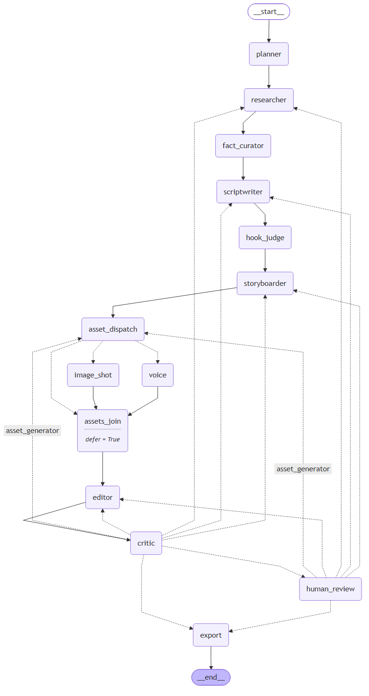

# AgentReel process report: {{team_id}} / {{brief_id}}

> Generated by `scripts/make_process_report.py` from run **{{run_id}}** on {{generated_at}}.
> Every table below is computed from `outputs/{{run_id}}/` and `logs/run_log.jsonl`. Text in *italics*
> marked EDIT is for the team to write before submission.

## 1. Brief

{{brief_table}}

## 2. System overview

AgentReel is a LangGraph state machine of 11 agents (Planner, Researcher, FactCurator, Scriptwriter,
HookJudge, Storyboarder, AssetGenerator, Editor, Critic, HumanReview, Export). All models run locally on
Kaggle's 2x T4 (llama.cpp for text/vision, subprocess workers for SDXL-Lightning, Kokoro, faster-whisper).
Sources are discovered live from official Somaiya and Government of India pages, snapshotted, and cited.

Autonomy: **{{autonomy}}**.

## 3. Run timeline (stage times)

{{stage_times_table}}

Total wall-clock (first to last log line): **{{wall_clock}}**.

## 4. Cost

Actual spend is Rs 0: every model is local and search uses Tavily's free tier. The shadow cost column
prices the same GPU time at an assumed public T4 rate (assumptions are listed in `logs/cost_report.csv`).

{{cost_table}}

## 5. Quality gate and critic loops

{{critic_loops}}

## 6. Creativity: auto A/B hooks

{{hooks}}

## 7. Human interventions and reviews

{{interventions}}

## 8. Sources and accuracy

{{sources}}

## 9. Reproducibility

- One command: `python run.py --brief briefs/{{brief_id}}.yaml --seed {{seed}}`
- Replay without network: add `--offline` (source snapshots in `data/sources/`, manifest-ordered).
- Re-run one stage: `--only scriptwriter`. Stage cache key = sha256(stage input, prompt files, models.yaml, seed).
- Log integrity: `python scripts/verify_logs.py` -> {{log_chain}}

Environment of this run:

{{environment}}

## 10. Deliverables

{{outputs}}

## 11. Reflection

*EDIT: what worked, what failed during dry runs, what the critic caught, and what we would change next
(e.g. auto-approval for A/C once every check passes, which the handout does not allow yet).*
